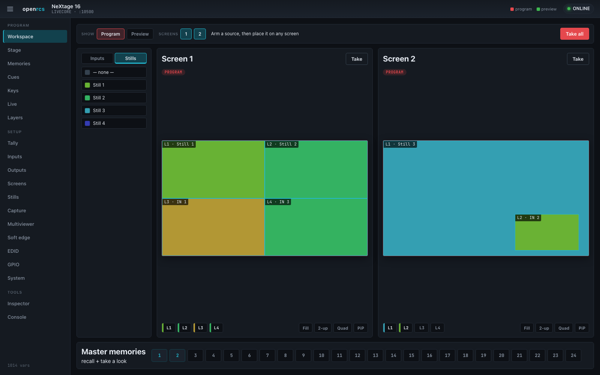

# openrcs

> **AI-assisted project.** This codebase was created with [Claude](https://claude.com/claude-code)
> (Anthropic), directed and reviewed by a human author. The protocol was
> reverse-engineered rather than taken from a published specification, apart from
> the LivePremier, Midra 4K and Alta 4K side and the PLS300, which follow the
> vendor's published protocol guides and what the devices themselves report.
> The LiveCore and Midra sides have both since been checked against real hardware,
> but how a unit behaves depends on its model, firmware and signal state, so check
> it against your own processor before a show. See [Status](#status).

A Rust library for controlling **Analog Way Midra, LiveCore, PLS300,
LivePremier, Midra 4K and Alta 4K** video processors over their own TCP
control protocols, with a browser control surface on top.

It covers the Midra family (Pulse2, Eikos2, Saphyr, SmartMatriX2, QuickMatriX,
QuickVu) and the LiveCore family (Ascender 16/32/48, NeXtage 8/16, SmartMatriX
Ultra), giving you a modern, dependency-light way to drive hardware whose
original software is long out of date. It also reaches one
generation further back to the **Pulse PLS300** (from its published
Programmer's Guide, and not met on the wire yet), and has an early mode for the
current range: **LivePremier** (Aquilon), **Midra 4K** (QuickVu 4K, Pulse 4K,
Eikos 4K, QuickMatrix 4K) and **Alta 4K** (Zenith 100/200), built on those
families' own published protocol.



**[Try the control surface in your browser →](https://openrcs-demo.stoatworks-labs.com)**
It's the actual UI, unmodified, running against a simulated device. There's no
processor involved and nothing can reach hardware: a browser can't open a raw TCP
socket, so the demo swaps out the transport and keeps the app. [demo/](demo/)
explains how it works and what it can't show.

Not affiliated with or endorsed by Analog Way. Product names are used only to
describe compatibility.

<!-- downloads:start -->

## Download

**[v0.11.1](https://github.com/stoatworks-labs/openrcs/releases/tag/v0.11.1)** — prebuilt for macOS, Windows and Linux. Pick your platform:

<details>
<summary><b>macOS</b> — Universal (Apple Silicon + Intel)</summary>

| Build | Download | Size |
| --- | --- | --- |
| Universal (Apple Silicon + Intel) · .dmg disk image (CLI) | [`openrcs-server-0.11.1-macos-universal-cli.dmg`](https://github.com/stoatworks-labs/openrcs/releases/download/v0.11.1/openrcs-server-0.11.1-macos-universal-cli.dmg) | 4.7 MB |
| .dmg disk image (app) | [`openrcs-0.11.1-macos-app.dmg`](https://github.com/stoatworks-labs/openrcs/releases/download/v0.11.1/openrcs-0.11.1-macos-app.dmg) | 13 MB |
| Universal (Apple Silicon + Intel) · .pkg installer (CLI) | [`openrcs-server-0.11.1-macos-universal-cli.pkg`](https://github.com/stoatworks-labs/openrcs/releases/download/v0.11.1/openrcs-server-0.11.1-macos-universal-cli.pkg) | 4.2 MB |
| .pkg installer (app) | [`openrcs-0.11.1-macos-app.pkg`](https://github.com/stoatworks-labs/openrcs/releases/download/v0.11.1/openrcs-0.11.1-macos-app.pkg) | 13 MB |
| Universal (Apple Silicon + Intel) · .tar.gz archive | [`openrcs-server-macos-universal.tar.gz`](https://github.com/stoatworks-labs/openrcs/releases/latest/download/openrcs-server-macos-universal.tar.gz) | 4.2 MB |

</details>

<details>
<summary><b>Windows</b> — x64, ARM64</summary>

| Build | Download | Size |
| --- | --- | --- |
| x64 · .exe installer | [`openrcs-server-0.11.1-windows-x86_64-setup.exe`](https://github.com/stoatworks-labs/openrcs/releases/download/v0.11.1/openrcs-server-0.11.1-windows-x86_64-setup.exe) | 1.6 MB |
| x64 · .exe installer | [`openRCS_0.11.1_x64-setup.exe`](https://github.com/stoatworks-labs/openrcs/releases/download/v0.11.1/openRCS_0.11.1_x64-setup.exe) | 3.9 MB |
| ARM64 · .exe installer | [`openrcs-server-0.11.1-windows-aarch64-setup.exe`](https://github.com/stoatworks-labs/openrcs/releases/download/v0.11.1/openrcs-server-0.11.1-windows-aarch64-setup.exe) | 1.4 MB |
| x64 · .zip archive | [`openrcs-server-windows-x86_64.zip`](https://github.com/stoatworks-labs/openrcs/releases/latest/download/openrcs-server-windows-x86_64.zip) | 1.8 MB |
| ARM64 · .zip archive | [`openrcs-server-windows-aarch64.zip`](https://github.com/stoatworks-labs/openrcs/releases/latest/download/openrcs-server-windows-aarch64.zip) | 1.8 MB |

</details>

<details>
<summary><b>Linux</b> — x64, ARM64</summary>

| Build | Download | Size |
| --- | --- | --- |
| x64 · .deb package (Debian/Ubuntu) | [`openrcs-server_0.11.1_amd64.deb`](https://github.com/stoatworks-labs/openrcs/releases/download/v0.11.1/openrcs-server_0.11.1_amd64.deb) | 2.3 MB |
| x64 · .deb package (Debian/Ubuntu) | [`openRCS_0.11.1_amd64.deb`](https://github.com/stoatworks-labs/openrcs/releases/download/v0.11.1/openRCS_0.11.1_amd64.deb) | 7.6 MB |
| ARM64 · .deb package (Debian/Ubuntu) | [`openrcs-server_0.11.1_arm64.deb`](https://github.com/stoatworks-labs/openrcs/releases/download/v0.11.1/openrcs-server_0.11.1_arm64.deb) | 2.4 MB |
| x64 · .rpm package (Fedora/RHEL) | [`openRCS-0.11.1-1.x86_64.rpm`](https://github.com/stoatworks-labs/openrcs/releases/download/v0.11.1/openRCS-0.11.1-1.x86_64.rpm) | 7.6 MB |
| x64 · .rpm package (Fedora/RHEL) | [`openrcs-server-0.11.1-1.x86_64.rpm`](https://github.com/stoatworks-labs/openrcs/releases/download/v0.11.1/openrcs-server-0.11.1-1.x86_64.rpm) | 2.4 MB |
| ARM64 · .rpm package (Fedora/RHEL) | [`openrcs-server-0.11.1-1.aarch64.rpm`](https://github.com/stoatworks-labs/openrcs/releases/download/v0.11.1/openrcs-server-0.11.1-1.aarch64.rpm) | 2.4 MB |
| x64 · .tar.gz archive | [`openrcs-server-linux-x86_64.tar.gz`](https://github.com/stoatworks-labs/openrcs/releases/latest/download/openrcs-server-linux-x86_64.tar.gz) | 2.2 MB |
| ARM64 · .tar.gz archive | [`openrcs-server-linux-aarch64.tar.gz`](https://github.com/stoatworks-labs/openrcs/releases/latest/download/openrcs-server-linux-aarch64.tar.gz) | 2.3 MB |

</details>

All builds, checksums and release notes: [github.com/stoatworks-labs/openrcs/releases](https://github.com/stoatworks-labs/openrcs/releases).

macOS builds are signed and notarised and open normally. The Windows builds are unsigned, so SmartScreen warns once.

<!-- downloads:end -->

## Status

`openrcs-proto`, the protocol engine, is implemented and tested. The LiveCore
command table (1014 variables) and the Midra table (562) are complete, with
per-variable dimensions, ranges and read-only flags. Both have been checked
against real hardware, a **NeXtage 16** (LiveCore) and a **Pulse2** (Midra):
device identity, framing, live layer control and takes, memories, EDID and the
per-platform quirks are all confirmed on the wire. The per-variable ranges are
still strong guidance rather than a guarantee, and a few behaviours depend on
model, firmware or a live input signal.

A bench session with both units the night before a show (2026-09-16) drove
every operator action at the hardware and fixed four things the simulators had
hidden. The **master fade** direction: the device's FADE_AUTO enum is 1 = up,
2 = to black, and openrcs was sending it the other way round. The **Midra
take**, which the unit ignores while its preset-update mode is on (openrcs used
to switch that mode on; now it keeps it off, and a Midra cut is the T-bar run
end to end). The **tally**, which is indexed by source number rather than by
input. And the **Wall**, which had been reading the output-to-screen map
backwards. The bridge also got a link watchdog: a processor that stops
answering is dropped after 20 s and shows OFFLINE instead of ONLINE, and every
memory erase or save-over asks for a second tap.

The show itself turned up a fifth (2026-09-17): a **LiveCore layer
edit never reached the wall**. The unit was in preset-update mode (the vendor's
own client puts every unit it meets into it), where a layer write is held until
a `GCupd` update, and openrcs never sent one. Now it sends one after every burst
of layer writes, as the vendor client does, so a resize or a source change on
program or preview lands straight away.

Two things v0.5.0 added need a word on what is and isn't proven. The
Midra **video out** (its three plug modes, its screen sources and its area of
interest) is confirmed on a Pulse2, including watching the SDI plug move between
outputs as the mode changes. The LiveCore **per-output area of interest** isn't:
the values stage and the apply is accepted, but on a NeXtage 16 the device's own
status readback never moved off a fixed size, so the panel shows that readback
rather than the numbers you typed in, and warns you when it sees it.

**The PLS300 is spelled out but unmet.** The 222-variable table comes from the
"Programmer's Guide For PLS300", the generation before Midra: the same
index,…,value framing and the same port, with one- or two-letter case-sensitive
mnemonics (`NC` and `Nc` are different variables), no outbound terminator at
all, and an `E11` for an index out of range. The surface gives it eight views of
its own: Live (take, T-bar, the five layer slots of the next preset, freeze,
output black), Layers (drag and resize on a canvas of the main output),
Memories (the four user presets and the previous look, through the unit's
preset-copy verb), Inputs, Outputs, Audio, Pictures (the six frames and six
logos) and System. All of it has only been driven against a fixture made from
the table. **No PLS300 has answered openrcs yet.** Two things the guide leaves
open are worth knowing before one does. The unit ships with LAN off
(`LANENABLE` 0 = RS-232 only; switch it on from the front panel first). And the
guide calls inputs 11–12 the DVI pair on one page and 9–10 on another, so the
HDCP and SDI de-embed controls go by what each input reports itself to be. The
Bitfocus `analogway-pls300` module was the only other evidence from the wire,
and I wouldn't trust it on this: it sends every command twice, never reads a
reply, and freezes the input after the one you asked for.

**LivePremier (Aquilon) is in field testing.** `openrcs-awj` implements the AWJ
protocol (JSON over TCP 10606, from Analog Way's published Programmer's Guide
rather than from reverse engineering), and the surface gets two views for it:
the screens in use with their transition state and take times, and the screen
preset bank. Reading has been tested against **two different Aquilon C frames**
on firmware 6.2.73, most recently on 2026-09-09, with `openrcs-awj`'s own
`awjprobe` example: model, labels, transition, preset letters and bank validity
all come back clean on both.

The controls that write (take, cut, preset recall, and the subscription list
behind "Live updates") have been run end to end against the **LivePremier
simulator**, and **the AWJ operations underneath them are now confirmed on real
hardware**: a TAKE measured at 1.07 s against a configured 1.0 s fade, a preset
saved and recalled onto preview, a recall of an empty slot passing silently, and
a second socket getting a push for a write made on the first, which is how "Live
updates" works. Those hardware writes were sent by a separate test harness
rather than by this code, so what's proven is the protocol, not yet `openrcs`'s
own write path. Treat the plumbing between the surface and the wire as
simulator-only for now, and the wire itself as settled.

Two hardware facts worth carrying into any AWJ client. An `x…` trigger property
stays `true` after it fires, so reading one back never confirms anything. And a
preset recall overwrites the screen's `takeUpTime`, so any fade has to be
written *after* the load, not before.

**Midra 4K and Alta 4K are the same protocol over a different object model**,
and `openrcs-awj` spells that model out too (`openrcs_awj::mng`): four screens
and four auxiliaries keyed by number in two lists, one `takeTime`, preset
buffers named, wonderfully, `UP` and `DOWN`, three banks (screen, auxiliary and
master, since the auxiliaries get one of their own), and "in service" read from
the applied configuration rather than the destination. Every path was read off
a **Pulse 4K on firmware 3.3.10** on 2026-09-12, and the LivePremier spellings
were read off the same box as a control. Every one of those answers `E12`
there, which is why the two are separate modules and why the surface tells you
when it's been pointed at the wrong one. The take, cut, recall and subscription
operations underneath were fired at that Pulse 4K by a separate test harness
and behaved as the LivePremier ones do (a subscribed second socket saw a write
within 40 ms).

`openrcs`'s own surface for these goes further than the LivePremier one:

- a **Show** page with every screen and auxiliary in service side by side, each
  screen's program or preview editable on its own canvas and taken alone or all
  together, with a Show mode of big targets for a front-of-house table;
- **Screens** with a T-bar, take time, freeze, copy-to-preview, step back, the
  preset toggle, Take all and the device's **quick preset** (fade to black, a
  library image or a master memory, on and off from one switch);
- a **Layers** editor: drag and resize a screen's live layers on its canvas with
  the unit's own pictures on them, set their sources, opacity, freeze and fader
  and every other property the device declares, plus the preset's
  **background** (a set or a colour) and **top frame**, or an auxiliary's
  background source;
- **Presets** that save, label and erase as well as recall, with a master save
  that refuses to overwrite the screen and aux slots the device would otherwise
  write without telling you;
- **Inputs** with thumbnails, plug, signal, freeze, black and the device's own
  tally lists;
- **Multiviewer**: the monitoring output's windows on a canvas, drag and resize,
  sources, twenty layout memories and the three timers;
- **Outputs**: role, format (applied through the device's own update trigger),
  plug, test pattern and picture settings;
- **Stills**: the fifty-slot library, a capture into it, and each screen's frame
  slots;
- **Audio**: the audio layer each preset buffer carries, what every screen,
  auxiliary, output, line out and Dante group follows or carries, mutes, the ten
  custom sources, level readings and the Dante card's state;
- **Setup**: the device's configuration (outputs to screens, layer resources to
  screens, auxiliaries, templates) staged, computed against the applied one and
  applied behind a second tap, each screen's canvas as a grid of outputs or free
  placement, and its test pattern;
- **System**: identity, network, temperatures, fans, the front panel, a reboot,
  the two on-device **configuration slots** (back up, restore, erase) and **RTMP
  streaming**;
- and an **Inspector** over any AWJ path with the wire log, which LivePremier
  gets too.

The Inputs page sets up a plug in full: signal type, HDCP, HDR, picture, aspect
and cropping, the chroma / luma / cut-and-fill **keyer**, and the **EDID** it
presents, loaded from the device's library. The Outputs page adds the **area of
interest** and pitch, HDR, colorimetry, the plug's HDCP, pixel encoding and
embedded audio, the connected display's EDID (saved into the library from here)
and **custom formats**. Presets show and set **what a save records**. Screens
take, cut and T-bar a ticked **group** of destinations. The Layers canvas
**snaps** to edges and centres, nudges from the arrow keys and copies a layer's
whole property set onto any other. On top of that there are twelve layout
presets, **autoscale on load** per screen and for the multiviewer, **LUTs** (the
two libraries named, erased and allocated to inputs, and a conversion and a
correction LUT picked per plug and per output) and **soft edge** on a grid
canvas's gaps for the models that blend. Two more pages serve LivePremier as
well: **Cues**, a cue list over the memory banks (recall to preview and take,
or cut, with per-cue autofollow; neither Web RCS has a sequencer), and
**Plan**, which stages every edit in the browser with no processor attached and
pushes the lot on connect.

All of it has been driven end to end against the vendor's **Midra 4K (3.2.29)
and Alta 4K (1.3.7) simulators** only, and anything the simulators accept but
don't act on is written but unproven: a timer never leaves `IDLE`, a capture
never completes, the tally lists never fill, a stream never starts, a custom
format is never erased, and a grid change never moves the canvas size. The
paths behind the newer views were spelled from the Pulse 4K's own store dump
rather than answered over AWJ by the unit (the simulators answer every one), so
a `get` of those on a real unit is still owed. One difference from the
LivePremier simulator is worth knowing: these two *do* reproduce the
recall-overwrites-the-take-time behaviour, so what you see on them is what the
hardware does.

`openrcs-server` adds a browser control surface over that engine, and it ships
as a system-tray app as well (see below). Roadmap: a standalone gateway (Pi or
ESP32) between the processor and its clients. The protocol engine is
`no_std`-friendly, so the same code backs all of them.

How all this compares with the vendor's own control software (the RCS² for
Midra, the Web RCS for LiveCore, LivePremier and Midra 4K, the original RCS for
the PLS300), feature by feature, with what's full, partial, missing or beyond
stock on each family: [docs/COMPARISON.md](docs/COMPARISON.md).

## Web control surface

`openrcs-server` connects a browser control panel to a processor. It holds one
TCP connection to the device, caches its state, and relays a small JSON protocol
over a websocket to as many browsers as you like.

It comes in two shapes, from the same release:

- **On your own machine: the desktop app.** A menu-bar / system-tray app for
  macOS, Windows and Linux (the `.dmg`/`.pkg` app, `-setup.exe` and
  `.deb`/`.rpm` app rows in the tables above) with the server inside it. Pick an
  interface and port, click **Start**, then **Open**. You set the switcher's
  address and model in the surface's own **Connection** view, and it remembers
  them. See [`launcher/`](launcher/README.md).
- **On the hardware: just the server.** The command-line packages (macOS
  `-cli.pkg`, `.deb`/`.rpm`, the Windows CLI installer, the archives) install
  the bare `openrcs-server` for a box in the rack that runs it as a service,
  with no tray and no desktop session. The UI is built in, so it's a single
  self-contained file.

Or run it from source:

```bash
cargo run -p openrcs-server -- --device <processor-ip> --platform livecore
# ...or --platform midra, --platform pls300 for a Pulse PLS300,
# --platform livepremier for an Aquilon,
# --platform midra4k for a QuickVu/Pulse/Eikos/QuickMatrix 4K,
# --platform alta4k for a Zenith 100/200
# then open http://127.0.0.1:8730/
```

The port is optional. Each family has its own (10500 for LiveCore, Midra and
the PLS300, 10606 for LivePremier, Midra 4K and Alta 4K) and it's filled in
from `--platform`.

`--device` is optional too. Without it the server starts unconfigured and you
set the processor from the **Connection** view in the UI (typed, tapped in on a
keypad, or picked from a network scan), and it's remembered for next time. That
makes the server usable on a machine with no handy command line, such as a
dedicated control panel.

`openrcs-server --version` (or `-V`) prints the version and, if the binary was
built from a git checkout, the short commit it came from
(`openrcs-server 0.7.0 (f219a9d)`), then exits. The same line opens the startup
banner, so a running server tells you which build it is. `--help` lists the
flags.

### Plugins

Beyond the core views, the surface is built from plugins. Each one's a folder
under `crates/openrcs-server/web/plugins/`, and each can be switched on or off
on the **Plugins** page. Most are ported from LivePremier Plus: field
arithmetic, layer names, layer groups with a gang and Send to, layer lock and
take-one-layer-alone, a command line, timecode (MTC, LTC, OSC), MIDI mapping,
the DaVinci Resolve Speed Editor, an EDID builder (the Otter editor), OSC input,
HyperDecks with Mitti-style rules, matrix routing (Videohub, Lightware, Turtle
AV), Companion buttons, a thumbnail relay, remote access over Tailscale or
ZeroTier, and a setup file. They run on LiveCore and Midra, but none has met a
processor yet. What each one does, how far each is proven, the OSC address
space and how to write your own: [docs/PLUGINS.md](docs/PLUGINS.md).

The Speed Editor plugs into the machine the server runs on, and the server
holds it. Chrome can't get a real panel past its handshake over WebHID, so the
page no longer tries. The server's handshake is the one LivePremier Plus has run
on a real panel over USB on macOS; openrcs's own build has only met a fake
panel so far, and nothing has tried it on Windows, Linux or Bluetooth.

The bridge keeps the plugins' shared data in `plugin-data.json` next to its
config, so every open page sees the same layer groups, decks and routers.

### Running it on a dedicated panel

`--tailnet` adds one more view, and it's **off unless you ask for it**. It
shows what the *host running the server* is called on your
[Tailscale](https://tailscale.com) tailnet and whether it's connected, and lets
you connect, disconnect and rename it from the touchscreen, with an on-screen
keyboard.

That's only useful, and only appropriate, on a box the control surface owns: an
appliance with no keyboard and no shell, where you otherwise can't answer "why
can't I reach this panel?" without carrying a laptop over to it. On an ordinary
install the flag is off, the view doesn't exist, and the server ignores the
messages behind it. The server enforces that itself, rather than leaving it to
a UI that hides a button.

```bash
openrcs-server --tailnet --listen 127.0.0.1:8730
```

Two things worth knowing before you turn it on:

- **The surface has no authentication.** Anyone who can reach the UI can take
  that host off the tailnet. Pair `--tailnet` with a loopback `--listen` (that's
  the default) unless you've got a reason not to.
- **The server doesn't need to be root, but it does need to be the operator.**
  `tailscale up --operator=<user>` grants that to the account the server runs
  as. Without it the view still shows up and every button returns "access
  denied".

The UI is **platform-aware**: it reads the variable table the device advertises
and only shows the views that processor supports. Everything centres on a
**Workspace** page with the sources (inputs and stills), every screen editable
side by side in program, preview or both at once, one-click layout presets and
the memories, all on one window-filling page. Behind it there's a **Stage**
overview and a **Wall** map that puts each screen at its real output position; a
graphical **Layers** editor (drag/resize, source, opacity, border, crop, layer
transitions, built-in layouts); **Destinations** that take, cut and T-bar whole
screen groups at once; **Memories** (master, screen and **layer** banks, with
each slot's device label, the processor's own twelve-category record filter on
every recall, and a layer bank that captures one layer's whole property set and
checks each recall by reading the layer back); **Cues** (a show script with
per-cue autofollow), **Keys** (one-tap macros) and **Live**; a big-target **Show
mode** for front-of-house; and **Shows**, which capture the device's whole state
to a portable file and restore it, with an instant **Confidence** undo and an
offline **Plan** mode that stages a look with no device attached and pushes it
on connect. Setup covers **Inputs**, **Outputs** (with a per-output area of
interest on LiveCore), **Video out** on a Midra (the frame's second output, with
its own format and a draggable crop of a screen), **Screens** with a **working
area** that keeps layers inside the part of a screen people can actually see,
**Stills**, a live **Tally**, **Capture**, **Multiviewer** and **Soft edge**
designers, **EDID** management with a custom-EDID writer, **GPIO** and
**System**. Under **Tools** there's an **Inspector** over every device variable
and a raw-protocol **Console**. It's a vanilla ES-module app with no
dependencies, served by the server, so there's no build step.

## Using the crate

```rust
use openrcs_proto::{encode_set_checked, Decoder, Frame, Platform};

// Drive screen 1's T-bar to 50% travel.
let cmd = encode_set_checked(Platform::Midra, "GCtba", &[1], 5000)?;
assert_eq!(cmd, "1,5000GCtba\r\n");

// Replies are the mirror image: mnemonic first, value last. The device also
// pushes unsolicited updates, so decode continuously.
let mut dec = Decoder::new();
for frame in dec.feed(b"GCtba1,5000\n") {
    match frame {
        Frame::Value(r) => println!("{} {:?} = {}", r.mnemonic, r.indices, r.value),
        Frame::Error(code) => eprintln!("device error {code}"),
    }
}
```

`encode_set_checked` checks index rank, index bounds, value range and read-only
status against the variable table. `encode_set` skips the checks for when you
want raw control.

```bash
cargo test                        # no hardware needed
cargo build --no-default-features # no_std (and a server with no USB panel support)

# Read-only probe against a device:
cargo run --example probe -- <device-ip>:10500 livecore
```

## The protocol in one paragraph

The mnemonic families speak a terse ASCII protocol over TCP 10500. Commands
put the mnemonic last (five characters on Midra and LiveCore, one or two
case-sensitive letters on the PLS300), replies put it first, and a reply's last
comma-separated field is the value. Midra ends outbound commands with CRLF,
LiveCore with LF, and the PLS300 with nothing at all, just to keep you on your
toes. The device pushes unsolicited updates and NAKs bad commands with
`E<code>`. There's a short summary in [`docs/PROTOCOL.md`](docs/PROTOCOL.md).

The full protocol reference (framing, the variable model, and every variable
for both platforms) lives in a companion repo:
**[openrcs-protocol](https://github.com/stoatworks-labs/openrcs-protocol)**.

## Drive it from a control surface

**[companion-module-openrcs](https://github.com/stoatworks-labs/companion-module-openrcs)**
is a [Bitfocus Companion](https://bitfocus.io/companion) module built on the same
protocol, for driving the switcher from a Stream Deck or another control
surface. It takes and cuts screens and groups, runs the T-bar, recalls memories,
and does freeze and black, with on-air tally.

<!-- attributions:start -->
This project is built on other people's work — see [ATTRIBUTIONS.md](ATTRIBUTIONS.md).
<!-- attributions:end -->

## Licence

MIT.
